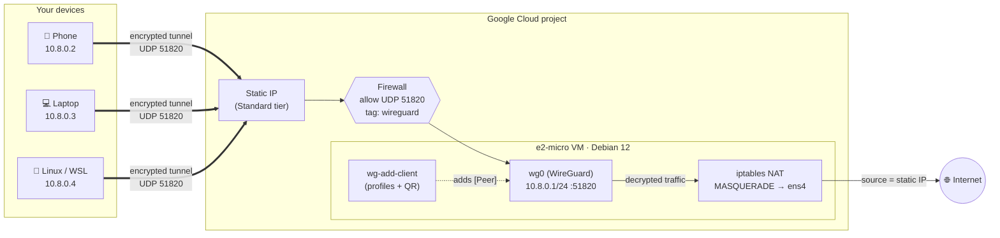
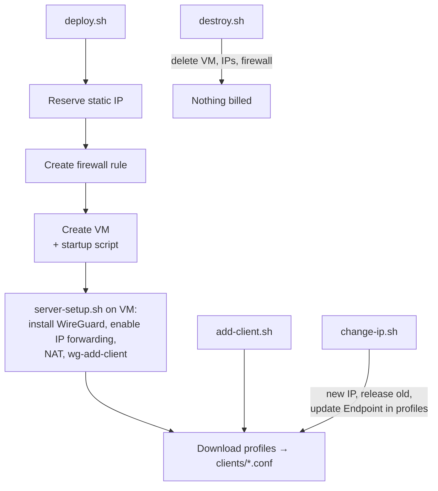

# gcp-wireguard-vpn

Your own WireGuard VPN on a Google Cloud e2-micro VM, set up with a few `gcloud` commands.

```
Your device ──encrypted UDP 51820──▶ GCP VM (WireGuard + NAT) ──▶ Internet
                                     websites see the VM's IP
```

## Architecture



**How a request flows**
1. A device sends traffic into its WireGuard tunnel (`AllowedIPs = 0.0.0.0/0`, so everything goes through the tunnel).
2. The packet reaches the VM's static IP on UDP 51820, which the firewall rule allows.
3. `wg0` decrypts it and checks the device's key against its `[Peer]` entry.
4. iptables NAT rewrites the source address to the VM's IP and sends the packet to the internet.
5. Replies come back the same way, encrypted, to the device.

**What the scripts do**



## Requirements
- A Google Cloud account with billing enabled (the $300 free trial is enough)
- [gcloud CLI](https://cloud.google.com/sdk/docs/install) on Linux, macOS or WSL
- The WireGuard app on each device: <https://www.wireguard.com/install/>

## 1. Install and log in to gcloud
```bash
curl https://sdk.cloud.google.com | bash
exec -l $SHELL
gcloud auth login
```

## 2. Create a project and link billing
```bash
gcloud projects create my-vpn-$RANDOM --name=wireguard-vpn
gcloud config set project <PROJECT_ID>                 # the ID printed above
gcloud billing accounts list                           # copy the ACCOUNT_ID
gcloud billing projects link <PROJECT_ID> --billing-account=<ACCOUNT_ID>
```

## 3. Deploy
```bash
./deploy.sh                    # creates profiles for "phone" and "laptop"
./deploy.sh phone laptop pc    # or name your own devices
```
This takes about 3 minutes. The device profiles are saved to `clients/<name>.conf`.

Region: the default is `us-central1-a`, where the e2-micro VM is free. To use a region closer to you (the VM then costs about $7/month):
```bash
ZONE=asia-southeast1-a ./deploy.sh
```
Use the same `ZONE=...` with every script below.

## 4. Connect a device
| Device | How |
|---|---|
| Phone | `./add-client.sh phone`, then in the WireGuard app tap **+ → Scan from QR code** |
| Windows / macOS | WireGuard app → **Import tunnel from file** → `clients/laptop.conf` |
| Linux | `sudo apt install wireguard-tools && sudo cp clients/pc.conf /etc/wireguard/ && sudo wg-quick up pc` |

Check it works: `curl ifconfig.me` should print the VM's IP.

Give every device its own profile. Two devices using the same profile kick each other off.

## Scripts
| Script | What it does |
|---|---|
| `deploy.sh [devices...]` | Creates a fixed IP, the firewall rule (UDP 51820) and the VM, then downloads the profiles |
| `add-client.sh <name>` | Adds a device, or re-downloads an existing one, and shows its QR code |
| `change-ip.sh` | Gives the VM a new public IP, releases the old one and updates every profile |
| `destroy.sh` | Deletes the VM, its IPs and the firewall rule |
| `server-setup.sh` | Runs on the VM on first boot: installs WireGuard, NAT and the `wg-add-client` helper |
| `common.sh` | Shared settings: `PROJECT`, `ZONE`, `VM_NAME` (override with env vars) |

`change-ip.sh` cuts off the VPN while it runs. Turn the VPN off on the machine running it first (`sudo wg-quick down <name>`), then re-import or edit the profiles on your devices afterwards.

## Useful commands
```bash
gcloud compute ssh wg-vpn --zone=us-central1-a --command='sudo wg show'   # connected devices
gcloud compute instances stop  wg-vpn --zone=us-central1-a                # pause (disk + IP still billed)
gcloud compute instances start wg-vpn --zone=us-central1-a
```

## Costs (approximate)
| Item | Cost |
|---|---|
| e2-micro VM | Free in us-central1/us-west1/us-east1, about $7/month elsewhere |
| Static IPv4 | About $3/month |
| Traffic leaving the VM (Standard tier) | About $0.085/GB, which is the main cost |

Set a budget alert at **Billing → Budgets & alerts**. Free-trial credit expires after 90 days.

## Notes
- WSL: the VPN only covers Linux traffic inside WSL. Use the Windows app to cover the whole PC.
- Profiles in `clients/` contain private keys. They are git-ignored, so never share or commit them.
- Each device has its own key plus a preshared key. To revoke a device, delete its `[Peer]` block from `/etc/wireguard/wg0.conf` on the VM, then run `sudo systemctl restart wg-quick@wg0`.
